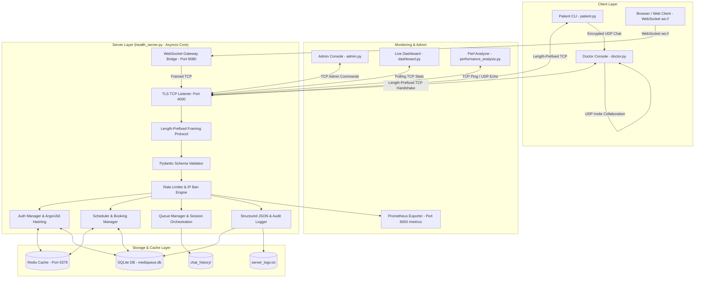

# MediQueue Connect

> **A Secure, Multi-Client Healthcare Consultation & Queue Management Platform built over TCP, UDP, and WebSockets.**

MediQueue Connect simulates a real-life hospital workflow. It enables patients to discover doctors, book appointments based on specialization, calendar dates, and insurance, wait in a priority triage queue if the doctor is busy, and establish secure, encrypted live UDP chat consultations. An integrated Admin Console, Live Metrics Dashboard, Performance Benchmarking tool, **Async Event-Driven Core**, **Length-Prefixed Binary Protocol Framing**, **Transactional SQLite Storage (WAL Mode)**, **Argon2id Password Security**, **Redis Session/Query Caching**, **Prometheus Telemetry Exporter**, **WebSocket Gateway Bridge**, and **Docker Compose Orchestration** provide a full-fledged demonstration of network and production backend engineering concepts.

---

## Quick Badges


---

## Table of Contents

1. [Overview](#overview)
2. [Key Architectural Highlights](#key-architectural-highlights)
3. [System Architecture](#system-architecture)
4. [Core Computer Network & Backend Concepts Used](#core-computer-network--backend-concepts-used)
5. [Project Structure](#project-structure)
6. [Installation & Requirements](#installation--requirements)
7. [Pre-configured Accounts & Doctor Specializations (For Testing)](#pre-configured-accounts--doctor-specializations-for-testing)
8. [Automated Test Suite](#automated-test-suite)
9. [Step-by-Step Run Guide](#step-by-step-run-guide)
10. [Feature Tour & Interactive Demos](#feature-tour--interactive-demos)
11. [Security Features & Controls](#security-features--controls)
12. [Troubleshooting & OS Compatibility Notes](#troubleshooting--os-compatibility-notes)
13. [Future Improvements & Production Status](#future-improvements--production-status)
14. [Contributors](#contributors)
15. [License](#license)

---

## Overview

MediQueue Connect bridges the gap between theoretical computer networking concepts and practical software engineering. Developed as part of the **Computer Communication and Networks (CCN/CN) curriculum**, this application leverages custom client-server application-layer protocols to orchestrate:

- **Patient Portal**: Profile registration, instant session token acquisition, comprehensive health profile management (blood group, drug/food allergies, chronic medical conditions), filterable scheduling based on health insurance eligibility, calendar date-based appointment scheduling, and real-time appointment booking.
- **Doctor Terminal**: Online/Offline toggle, credential authentication (`DOCTOR_LOGIN`), instant clinical intake card display (blood group, allergies, chronic ailments), live consultation channel, and a multi-peer clinical invite system.
- **Queue Orchestration Engine**: Emergency Severity Index (ESI Levels 1–5: Resuscitation to Routine) triage priority queue with continuous anti-starvation dynamic priority age deduction (`-0.25` effective level boost per 60 seconds), automatic turn notification, and non-blocking queue exit.
- **Secure Chat & Media Layer**: A hybrid messaging channel that negotiates ephemeral Curve25519 ECDH session keys via TCP with Perfect Forward Secrecy, routes low-latency Fernet-encrypted conversation messages over Reliable UDP (R-UDP) with sequence ARQ and positive ACKs, supports in-band encrypted consultation file and lab report transfers (`/sendfile`), and synchronizes live consultation transcripts directly into audit-grade JSONL logs.
- **Digital Prescription (Rx) Engine**: Enables physicians to generate structured digital prescriptions with diagnosis, dosage schedules, dietary advice, and authentic verification tokens rendered directly into PDF exports.
- **WebSocket Gateway Bridge**: A FastAPI / Uvicorn bridge (`/ws`) translating browser WebSocket JSON frames into 4-byte length-prefixed binary TCP packets.
- **Doctor Reviews & Feedback Engine**: Post-consultation patient evaluation system collecting 1–5 star ratings and clinical feedback stored in SQLite with running averages.
- **Prometheus Telemetry Exporter**: Real-time HTTP `/metrics` exporter exposing request counters, active connection gauges, doctor queue depth stats, and p95/p99 latency histograms.
- **Admin Command Center**: Database manager allowing admins to delete bookings, audit session transcripts, unban IPs, inspect audit trails with keyword filtering, export audit logs to CSV, and broadcast messages to all connected entities.
- **Live Monitor Dashboard**: Uptime tracking, message/booking statistics counters, and live visualization of doctor workloads, patient queues, and banned IPs.
- **Performance Evaluator**: Side-by-side RTT latency analyzer comparing TCP control traffic against UDP echo streams.

---

## Key Architectural Highlights

The primary engineering milestones and technical design highlights built into MediQueue Connect include:

- **Event-Driven Async Networking Core**: Architected an event-driven `asyncio` TCP socket server operating with 4-byte big-endian binary protocol framing to prevent TCP stream chunk fragmentation.
- **Distributed Asynchronous Task Queue (Celery & RabbitMQ)**: Integrated Celery task workers backed by RabbitMQ AMQP brokers to offload heavy transcript PDF summary rendering and statutory Email/SMS appointment reminders off the main socket thread loop.
- **Redis In-Memory Session & Query Caching**: Implemented Redis session token storage with automatic TTL key expiration and write-through slot query caching to minimize database read latency under high traffic.
- **Zero-Trust Security & Input Validation**: Enforced Pydantic v2 input schema validation, salt-protected Argon2id password hashing, and token-bucket rate limiting to defend against packet flooding and injection attacks.
- **Prometheus Operational Telemetry**: Instrumented Prometheus operational metrics exposing connection gauges, doctor queue depth metrics, and p95/p99 request latency histograms for operational observability.
- **WebSocket API Gateway Bridge**: Engineered a FastAPI / Uvicorn WebSocket gateway bridging browser WebSockets (`ws://`) to 4-byte length-prefixed binary TCP backend socket servers.
- **Docker Multi-Container Orchestration**: Containerized the multi-service backend architecture using Docker and Docker Compose for single-command orchestration across Health Server, Redis, RabbitMQ, Celery Worker, WebSocket Gateway, and Prometheus exporter.

---

## System Architecture

The following diagram illustrates how the core components communicate using TCP, UDP, WebSockets, local SQLite datastores, Redis cache, Prometheus telemetry, and the publish-subscribe model:



---

## Core Computer Network & Backend Concepts Used

MediQueue Connect is a sandbox for demonstrating several primary networking and backend engineering paradigms:

1. **Transport Protocol Selection**:
   - **TCP (Transmission Control Protocol)** is utilized for session establishment, authentication, slot scheduling, administrative tasks, and pub-sub notifications where data integrity and in-order delivery are non-negotiable.
   - **UDP (User Datagram Protocol)** is used for actual chat messaging and doctor-to-doctor invitations. Because UDP avoids connection overhead, it offers low latency suited for real-time interaction.
   - **WebSockets**: Utilized via a FastAPI gateway bridge (`websocket_gateway.py`) to connect web browser clients to backend TCP sockets.
2. **Length-Prefixed Binary Protocol Framing**:
   - Communication between client and server relies on a custom 4-byte big-endian length-prefixed binary framing protocol (`protocol.py`) to prevent TCP packet fragmentation and buffer boundary errors across network chunks.
3. **Async Event-Driven Concurrency**:
   - The Health Server uses an event-driven `asyncio` loop (`asyncio.start_server`) utilizing OS event multiplexers (`epoll` / `select`) to handle thousands of concurrent socket connections cleanly.
4. **Publish-Subscribe Pattern**:
   - Clients invoke a persistent `SUBSCRIBE` command. The server holds these open connections in an active subscriber list. If the admin broadcasts a global message or terminates a session, the server pushes the payload down all subscriber sockets instantly.
5. **Stateful Session Management & Redis Caching**:
   - Transient UUID session tokens are generated upon successful login. Tokens are cached in **Redis** (`cache.py`) with TTL expiration (`EXPIRE`), maintaining state across disconnected TCP transactions without requiring credentials to be re-transmitted.
6. **Rate Limiting & DDoS Prevention**:
   - A token-bucket algorithm monitors incoming IP addresses. Request frequency exceeding defined thresholds triggers a temporary 5-minute IP ban, simulating firewalls and intrusion prevention systems.
7. **Transactional SQLite Database (WAL Mode)**:
   - Persistent storage uses an embedded SQLite database (`mediqueue.db`) operating in Write-Ahead Logging (`WAL`) mode with foreign keys enabled, providing ACID guarantees and crash recovery.
8. **Argon2id Password Hashing & Salted Fallback**:
   - Passwords are secured using state-of-the-art Argon2id hashing (`argon2-cffi`) with automatic legacy migration and graceful salted SHA-256 fallback when dependencies are missing.
9. **Prometheus Operational Telemetry**:
   - Real-time operational metrics are exposed via HTTP `/metrics` on port `8000` (`metrics.py`), including request counters, active connection gauges, queue depth stats, and p95/p99 latency histograms.
10. **Docker Compose Multi-Container Orchestration**:
    - Containerized using `Dockerfile` and `docker-compose.yml` orchestrating Health Server, Redis cache, RabbitMQ, Celery Worker, WebSocket Gateway, and Prometheus exporter.
11. **Reliable UDP (R-UDP) Transport with Sequence ARQ**:
    - Custom Stop-and-Wait / Go-Back-N Automatic Repeat reQuest (ARQ) framing with 32-bit sequence numbers, positive ACK packets, MD5 payload checksum verification, and duplicate packet deduplication implemented over raw UDP datagrams (`rudp.py`).
12. **Perfect Forward Secrecy via Ephemeral ECDH (X25519)**:
    - Peer-to-peer Elliptic Curve Diffie-Hellman ephemeral key negotiation on Curve25519 with HKDF-SHA256 key derivation (`crypto_utils.py`), guaranteeing that historical session transcripts cannot be decrypted even if long-term credentials are compromised.
13. **Dynamic Priority Queueing & Anti-Starvation Scheduling**:
    - Emergency Severity Index (ESI Levels 1–5: Resuscitation to Routine) triage queue management (`queue_manager.py`) with continuous anti-starvation age deduction (`-0.25` effective ESI level boost per 60 seconds of waiting).
14. **In-Band Encrypted Medical File & Report Transfer**:
    - Chunked binary-to-Base64 file transfer protocol (`file_transfer.py`) streaming encrypted clinical documents and lab reports directly across the R-UDP session socket.

---

## Project Structure

```text
MediQueue-Connect/
│
├── requirements.txt            # Package dependencies (cryptography, pydantic, argon2-cffi, pytest, redis, prometheus-client, fastapi, uvicorn, websockets, celery, kombu, reportlab)
├── Dockerfile                  # Multi-stage Docker build file
├── docker-compose.yml          # Docker Compose orchestration (Health Server, Redis, RabbitMQ, Celery Worker, WebSocket Gateway)
├── run_demo.bat                # Windows automated launcher script (--test flag supported)
├── run_demo.sh                 # Linux/macOS automated launcher script (--test flag supported)
├── LICENSE                     # GPLv3 License
├── README.md                   # Project Documentation
│
├── clients/
│   ├── patient.py              # CLI client for patient registration, booking, and UDP chat
│   └── doctor.py               # CLI endpoint for online status updates and UDP consultation
│
├── server/
│   ├── health_server.py        # Central Asyncio TCP socket server & dispatcher
│   ├── celery_app.py           # Celery application configuration & RabbitMQ broker setup
│   ├── tasks.py                # Background Celery task routines (PDF exporter, Email/SMS notifications)
│   ├── pdf_generator.py        # ReportLab medical transcript PDF summary builder
│   ├── db.py                   # Transactional SQLite manager (WAL mode) & JSON seed engine
│   ├── cache.py                # Redis session & slot query cache manager with in-memory fallback
│   ├── metrics.py              # Prometheus metrics counters, gauges, histograms & HTTP exporter
│   ├── websocket_gateway.py    # FastAPI WebSocket-to-TCP protocol gateway bridge (Port 8080)
│   ├── schemas.py              # Pydantic input validation models for RPC commands
│   ├── protocol.py             # 4-byte length-prefixed binary framing protocol helper
│   ├── auth.py                 # Handles Argon2id hashed password storage & Redis session caching
│   ├── scheduler.py            # SQLite-backed appointment manager & slot query cache
│   ├── queue_manager.py        # Handles doctor busy states, ESI triage & dynamic priority queues
│   ├── rudp.py                 # Reliable UDP (R-UDP) transport with sequence ARQ and ACKs
│   ├── file_transfer.py        # Encrypted in-band consultation file & lab report transfer
│   ├── chat_history.py         # Logs session transcripts to JSONL format
│   ├── crypto_utils.py         # Ephemeral ECDH X25519 & symmetric Fernet encryption helpers
│   ├── logger.py               # Structured JSON logger & audit trail recorder
│   ├── admin.py                # Command-line interface for administrative operations
│   ├── dashboard.py            # Live-updating ANSI terminal dashboard
│   └── performance_analysis.py # Comparative TCP vs UDP latency benchmark utility
│
├── tests/
│   ├── test_db.py              # Unit tests for SQLite storage, Argon2id, and scheduler
│   ├── test_cache.py           # Unit tests for Redis session caching and query invalidation
│   ├── test_metrics.py         # Unit tests for Prometheus counter and gauge metrics
│   ├── test_protocol.py        # Unit tests for length-prefixed framing and fallback handling
│   ├── test_tasks.py           # Unit tests for Celery tasks and PDF summary exporter
│   └── test_server_integration.py # Async integration tests for full server lifecycle
│
└── data/
    ├── mediqueue.db            # SQLite database (ACID storage for users, doctors, bookings, audit logs)
    ├── server_logs.txt         # Server runtime event log
    ├── notifications.log       # Audit log for background Email/SMS notification dispatches
    ├── certs/                  # Auto-generated TLS certificates (server.crt, server.key)
    ├── chat_history/           # Folder containing audit trails for patient-doctor conversations
    ├── summaries/              # Formatted PDF consultation summary exports
    ├── attachments/            # Storage for encrypted consultation attachments and lab reports
    └── exports/                # Compliance audit log CSV exports
```

---

## Installation & Requirements

### Dependencies
- **Python**: Version 3.10 or higher.
- **Packages**: `cryptography`, `pydantic`, `argon2-cffi`, `pytest`, `redis`, `prometheus-client`, `fastapi`, `uvicorn`, `websockets`, `celery`, `kombu`, `reportlab`.

### 1) Clone and Prepare Environment

Open your terminal or PowerShell and run:

```bash
# Clone the repository
git clone https://github.com/AishikTokdar/MediQueue-Connect.git
cd MediQueue-Connect

# Create a virtual environment
python -m venv .venv

# Activate the virtual environment
# On Windows (PowerShell):
.\.venv\Scripts\Activate.ps1
# On Windows (CMD):
.\.venv\Scripts\activate.bat
# On Linux / macOS:
source .venv/bin/activate

# Install required packages
pip install -r requirements.txt
```

---

## Pre-configured Accounts & Doctor Specializations (For Testing)

### Patient Accounts
To log in immediately, use any of the pre-configured patients. Pre-seeded accounts use `pass<N>` as default credentials, and newly registered accounts authenticate with their chosen password:

| Username | Default Password | Covered Specializations | Pre-registered Insurance |
| :--- | :--- | :--- | :--- |
| `patient1` | `pass1` | General Physician, Cardiologist, Dermatologist, Neurologist, Orthopedic, Pediatrician | `insuranceA` |
| `patient2` | `pass2` | General Physician, Cardiologist, Dermatologist, Neurologist, Orthopedic, Pediatrician | `insuranceB` |
| `patient3` | `pass3` | General Physician, Cardiologist, Dermatologist, Neurologist, Orthopedic, Pediatrician | `insuranceA`, `insuranceB` |
| `patient4` | `pass4` | General Physician, Cardiologist, Dermatologist, Neurologist, Orthopedic, Pediatrician | `insuranceA` |
| `patient5` | `pass5` | General Physician, Cardiologist, Dermatologist, Neurologist, Orthopedic, Pediatrician | `insuranceB` |
| `patient6` | `pass6` | General Physician, Cardiologist, Dermatologist, Neurologist, Orthopedic, Pediatrician | `insuranceA`, `insuranceB` |

### Doctor Registry & Specialization Matrix (`data/mediqueue.db` / `data/doctors.json`)

Doctors are categorized into specific specializations and accept different insurance policies. Doctors authenticate via `DOCTOR_LOGIN` with default credentials `<doctor_id>123` (e.g., `doctor1123` for `doctor1`):

| Doctor ID | Default Password | Specialization | Accepted Insurance | UDP Port | Available Slots |
| :--- | :--- | :--- | :--- | :--- | :--- |
| `doctor1` | `doctor1123` | General Physician | `insuranceA`, `insuranceB` | `5001` | `10AM`, `11AM` |
| `doctor5` | `doctor5123` | General Physician | `insuranceA` | `5005` | `9AM`, `12PM` |
| `doctor6` | `doctor6123` | General Physician | `insuranceB` | `5006` | `2PM`, `5PM` |
| `doctor2` | `doctor2123` | Cardiologist | `insuranceB` | `5002` | `12PM`, `1PM` |
| `doctor7` | `doctor7123` | Cardiologist | `insuranceA` | `5007` | `9AM`, `10AM` |
| `doctor8` | `doctor8123` | Cardiologist | `insuranceA`, `insuranceB` | `5008` | `2PM`, `3PM`, `4PM` |
| `doctor3` | `doctor3123` | Dermatologist | `insuranceA` | `5003` | `2PM`, `3PM` |
| `doctor9` | `doctor9123` | Dermatologist | `insuranceB` | `5009` | `11AM`, `12PM` |
| `doctor10` | `doctor10123` | Dermatologist | `insuranceA`, `insuranceB` | `5010` | `9AM`, `1PM`, `5PM` |
| `doctor4` | `doctor4123` | Neurologist | `insuranceA`, `insuranceB` | `5004` | `9AM`, `10AM`, `4PM` |
| `doctor11` | `doctor11123` | Neurologist | `insuranceA` | `5011` | `10AM`, `11AM` |
| `doctor12` | `doctor12123` | Neurologist | `insuranceB` | `5012` | `1PM`, `2PM`, `3PM` |
| `doctor13` | `doctor13123` | Orthopedic | `insuranceA` | `5013` | `9AM`, `11AM` |
| `doctor14` | `doctor14123` | Orthopedic | `insuranceB` | `5014` | `2PM`, `4PM` |
| `doctor15` | `doctor15123` | Pediatrician | `insuranceA`, `insuranceB` | `5015` | `10AM`, `1PM`, `3PM` |
| `doctor16` | `doctor16123` | Pediatrician | `insuranceA` | `5016` | `9AM`, `12PM` |

*Note: You can also register new doctors dynamically using `python clients/doctor.py`.*

---

## Automated Test Suite

To run the automated `pytest` test suite:

```bash
python -m pytest -v tests/
```

*Expected Output:*
```text
============================= test session starts =============================
collected 12 items

tests/test_cache.py::test_cache_manager_session PASSED                   [  8%]
tests/test_cache.py::test_cache_manager_slots PASSED                     [ 16%]
tests/test_db.py::test_auth_manager_register_and_login PASSED            [ 25%]
tests/test_db.py::test_scheduler_doctor_and_booking PASSED               [ 33%]
tests/test_db.py::test_audit_logs PASSED                                 [ 41%]
tests/test_metrics.py::test_prometheus_metrics PASSED                    [ 50%]
tests/test_protocol.py::test_framed_protocol_pack_unpack PASSED          [ 58%]
tests/test_protocol.py::test_framed_protocol_legacy_fallback PASSED      [ 66%]
tests/test_server_integration.py::test_full_server_async_request_flow PASSED [ 75%]
tests/test_tasks.py::test_pdf_generator_directly PASSED                  [ 83%]
tests/test_tasks.py::test_generate_session_summary_pdf_task PASSED       [ 91%]
tests/test_tasks.py::test_email_and_sms_reminder_tasks PASSED             [100%]

============================= 12 passed in 0.81s ==============================
```

---

## Step-by-Step Run Guide

You can run MediQueue Connect either using the **Automated Launcher Scripts** (one-click startup for all components), **Manually Step-by-Step**, or via **Docker Compose Containers**.

---

### Option A: Automated One-Click Launcher (Recommended)

Automated scripts spawn the Health Server, Doctor processes, and Dashboard in separate background windows, leaving your primary terminal ready for Patient interaction:

#### On Linux / macOS / WSL / Git Bash:
```bash
chmod +x run_demo.sh
./run_demo.sh
```

#### On Windows (CMD / PowerShell):
```cmd
run_demo.bat
```

*What the launcher does automatically:*
1. Starts the TLS-Secured Health Server on port `4000` and Prometheus exporter on port `8000`.
2. Boots `doctor1` (General Physician) on UDP port `5001`.
3. Boots `doctor2` (Cardiologist) on UDP port `5002`.
4. Starts the Live Monitoring Dashboard.
5. Connects your main terminal directly into the Patient CLI (`clients/patient.py`).

---

### Option B: Manual Step-by-Step Execution

If you prefer launching each component manually across separate terminal windows:

#### Step 1: Start the Health Center Server & Prometheus Exporter
Open **Terminal 1** and start the central TLS control server:
```bash
python server/health_server.py
```

#### Step 2: Launch WebSocket Gateway Bridge (Optional for Web Clients)
Open **Terminal 2**:
```bash
python server/websocket_gateway.py
```

#### Step 3: Launch Doctor Clients
Open **Terminal 3** (and optionally **Terminal 4**) to set doctors online or register new doctor profiles:
```bash
python clients/doctor.py doctor1
```

#### Step 4: Launch Patient Clients
Open **Terminal 5** to initiate appointment bookings or live consultations:
```bash
python clients/patient.py
```

#### Step 5: Launch the Live Dashboard (Optional)
Open **Terminal 6** to view real-time system metrics, doctor availability, queue positions, and server logs:
```bash
python server/dashboard.py --interval 2
```

#### Step 6: Launch the Admin Console (Optional)
Open **Terminal 7** to execute administrative commands:
```bash
python server/admin.py
```

#### Step 7: Run Network Performance Analysis (Optional)
Open **Terminal 8** to benchmark TCP vs UDP latency under customizable round-trip counts:
```bash
python server/performance_analysis.py --rounds 50 --payload 128
```

---

### Option C: Docker Compose Method

To spin up the entire multi-service containerized stack (Health Server, Redis cache, RabbitMQ, Celery Worker, WebSocket Gateway, Prometheus exporter) with a single command:

```bash
docker compose up --build -d
```

---

## Feature Tour & Interactive Demos

### 1. Booking a Slot & Patient Scheduling
1. Run `patient.py` and log in as `patient1` (password: `pass1`).
2. Choose **Option 1: Book appointment**.
3. Select a specialization (e.g., *General Physician*) or type `0` to list all doctors.
4. The patient client will list only doctors who accept `insuranceA` (matching `patient1`'s profile).
5. Specify an appointment date (press Enter for today's date `YYYY-MM-DD` or input a future date).
6. Select a doctor (e.g. `doctor1`) and type an available slot (e.g., `10AM`).
7. Confirm booking. The client will query if you want to chat now. Choosing `yes` immediately launches the consultation routing.

### 2. Real-time Queue Orchestration & ESI Triage
If a doctor is already consulting a patient, incoming patients are triaged into a priority waiting queue:
1. Ensure `doctor1` is online (`python clients/doctor.py doctor1`).
2. Start Patient Terminal A (`patient1`), start a chat with `doctor1`. An active consultation session begins.
3. Start Patient Terminal B (`patient2`), attempt to chat with `doctor1`.
4. Patient B is prompted to select an **Emergency Severity Index (ESI)** urgency level (Level 1: Critical/Resuscitation to Level 5: Routine).
5. Patient B receives a queue ticket: `Doctor is busy. You are #1 in the queue (ESI Level X).`
6. Anti-starvation scheduling continuously adjusts effective queue position (deducting `0.25` every 60 seconds) so routine patients are never permanently starved by later emergent arrivals.
7. Pressing `c` sends a non-blocking `CANCEL_QUEUE` packet to exit gracefully.
8. When Patient A ends the consultation, the server dispatches a `TURN_READY` TCP packet to Patient B, automatically establishing their consultation channel.

### 3. Consultation Layer (PFS Encryption & Reliable UDP)
- **Perfect Forward Secrecy (ECDH X25519)**:
  - Upon starting a consultation session, the doctor and patient endpoints execute an ephemeral Curve25519 Diffie-Hellman key exchange.
  - A unique session key is derived via HKDF-SHA256, guaranteeing Perfect Forward Secrecy (PFS).
- **Reliable UDP (R-UDP) Transport**:
  - Chat packets are framed with 32-bit sequence numbers and verified via MD5 checksums over UDP datagrams.
  - Automatic Repeat reQuest (ARQ) retransmits dropped frames, and duplicate datagrams are discarded automatically.
- **Graceful Plaintext Fallback**:
  - If cryptographic libraries are unavailable, sockets gracefully negotiate plaintext transmission with clear terminal warnings.

### 4. Encrypted In-Band File & Lab Report Transfer
During an active consultation, either party can transfer clinical reports or lab PDFs:
1. In the chat prompt, type:
   ```text
   /sendfile <path_to_file>
   ```
2. The file is read, Base64-encoded, fragmented into R-UDP chunks, and encrypted with the session key.
3. The receiving endpoint verifies chunk integrity, reassembles the file, and saves it into `data/attachments/`.

### 5. Doctor-to-Doctor Invite Feature (Collaboration)
While engaged in a live chat, doctors can invite offline/online colleagues for a joint consultation:
1. During an active chat with a patient, the doctor can type:
   ```text
   /invite doctor2
   ```
2. If the second doctor is online (on their designated port), they receive the invitation packet and join the active chat session.
3. Messages are broadcasted across all participating endpoints.

### 6. Digital Prescriptions (Rx) & PDF Consultation Summaries
When a consultation concludes:
1. The doctor client prompts to issue a digital prescription (`ISSUE_PRESCRIPTION`) specifying diagnosis, medications (name, dosage, frequency, duration), and dietary instructions. Prescriptions are cryptographically signed with unique verification IDs and saved to SQLite.
2. The doctor client prompts to generate a formatted PDF consultation summary (`GENERATE_TRANSCRIPT_PDF`). A background Celery worker assembles the chat transcript and prescription into a medical PDF saved to `data/summaries/`.

### 7. Patient Doctor Reviews & Star Ratings
After a consultation ends:
1. The patient client prompts the patient to evaluate their experience:
   ```text
   Rate Dr. doctor1 (1-5 stars): 5
   Consultation feedback / comments: Dr. doctor1 was very thorough and attentive.
   ```
2. The review is stored in SQLite (`reviews` table) and factors into the doctor's public satisfaction metrics.

### 8. Admin Global Controls & Compliance Auditing
Using `python server/admin.py`:
- **Global Broadcast**: Select **Option 4** and type a message. All connected doctors and patients instantly receive a highlighted server broadcast alert in their consoles.
- **Kill Session**: Select **Option 3**, view active sessions, and type `kill <session_number>`. The server transmits a termination packet to the subscriber thread of both patient and doctor, ending the consultation immediately.
- **Audit Log Search & CSV Export**: Select **Option 5** to view immutable security audit records stored in SQLite, filter by user or action keyword, and export compliance audit reports to `data/exports/audit_logs.csv`.

---

## Security Features & Controls

MediQueue Connect includes production security features suited for local socket networks and distributed microservices:

### Rate Limiting & Auto-Ban
- Prevents socket flooding (denial of service).
- Configured in `server/health_server.py` via `RateLimiter`:
  - **Bucket capacity**: 2 tokens.
  - **Refill rate**: 10 tokens per second.
  - **Ban duration**: 300 seconds (5 minutes).
- Triggering the rate limit returns a `BANNED: Rate limit exceeded` JSON response and ignores subsequent packets from that IP.

### Argon2id Password Hashing & Schema Validation
- Client passwords are never stored in plaintext.
- Passwords are submitted to the server, hashed using **Argon2id** (`argon2-cffi`), and compared against salt-protected values stored in SQLite (`users` table).
- All incoming RPC command packets are validated against **Pydantic v2** models before reaching core business logic.

---

## Troubleshooting & OS Compatibility Notes

### Windows Console Colors
If ANSI escape sequences (like `\033[91m`) appear as raw characters in Windows Command Prompt, run the script once to enable virtual terminal processing, or use Windows Terminal (PowerShell).

### UDP Port Conflicts
Each doctor operates on a dedicated UDP port defined in `data/doctors.json` (ranging from `5001` to `5016`). If you receive a socket bind error, verify that no other process is using those ports:
- On Windows: `netstat -ano | findstr <port>`
- On Linux: `sudo lsof -i :<port>`

---

## Future Improvements & Production Status

To transition MediQueue Connect from an educational prototype into an enterprise-ready telemedicine network, 25 comprehensive architectural features have been implemented across the backend, networking, clinical, and security layers. Additional roadmap enhancements are detailed below:

### Implemented Architectural Features

- **Cross-Platform Non-Blocking Queue Management**: Built cross-platform non-blocking user input detection (`clients/patient.py`) utilizing `msvcrt` on Windows and POSIX `select.select`/`termios` on Linux/macOS for responsive queue cancellation (`c`) without stalling threads.
- **TLS/SSL Encrypted Socket Transport**: Hardened the core TCP control plane (`health_server.py`) and all clients (`patient.py`, `doctor.py`, `admin.py`, `dashboard.py`) using Python's `ssl` module with automated local RSA-2048 certificate generation.
- **Dynamic Doctor Registration Protocol**: Implemented dynamic registration (`REGISTER_DOCTOR`) enabling doctor terminals to self-register their specialization, accepted insurance plans, and dedicated UDP ports at runtime without static config dependencies.
- **ACID-Compliant SQLite Persistence (WAL Mode)**: Replaced flat JSON files with a transactional SQLite database (`mediqueue.db`) operating in Write-Ahead Logging (`WAL`) mode with foreign key integrity.
- **Length-Prefixed Binary Protocol Framing**: Designed a 4-byte big-endian length-prefixed framing layer (`protocol.py`) eliminating TCP packet fragmentation, message truncation, and boundary errors across all network sockets.
- **Argon2id Authentication & Pydantic Schema Validation**: Protected user/doctor credentials using memory-hard Argon2id hashing (`argon2-cffi`) with automatic legacy migration, and validated all incoming RPC payloads with Pydantic v2 schemas (`schemas.py`).
- **Redis Session Caching & Write-Through Query Caching**: Integrated distributed Redis caching (`cache.py`) for ephemeral session tokens (`session:<token>`) with automatic TTL expiration, alongside write-through slot query caching with thread-safe memory fallback.
- **Prometheus Telemetry & Observability Exporter**: Integrated an operational metrics exporter on port `8000` (`metrics.py`) exposing counters, active connection gauges, queue depth gauges, and latency histograms for Prometheus scraping.
- **FastAPI / Uvicorn WebSocket Gateway Bridge**: Built an asynchronous WebSocket gateway (`websocket_gateway.py`) translating browser-compatible JSON WebSocket frames into framed binary TCP RPCs.
- **Docker Multi-Container Orchestration**: Structured full-stack containerization via `Dockerfile` and `docker-compose.yml` orchestrating Health Server, Redis, RabbitMQ, Celery Worker, WebSocket Gateway, and Prometheus.
- **Distributed Celery Background Worker & PDF Consultation Export**: Offloaded CPU-heavy tasks via Celery and RabbitMQ (`celery_app.py`, `tasks.py`), including ReportLab-powered PDF consultation summary generation (`data/summaries/`) and async notification delivery.
- **Ephemeral ECDH (X25519) Key Exchange with Forward Secrecy**: Replaced pre-shared static keys with peer-to-peer Curve25519 Elliptic Curve Diffie-Hellman key exchange and HKDF-SHA256 key derivation (`crypto_utils.py`), guaranteeing Perfect Forward Secrecy (PFS) for consultation sessions.
- **Doctor Authentication & Role-Based Access Control (RBAC)**: Added credential-backed doctor authentication (`DOCTOR_LOGIN`) and role-based access control protecting clinical endpoints (`ISSUE_PRESCRIPTION`, `GET_PATIENT_INTAKE`, `DOCTOR_ONLINE`) from unauthorized patient requests.
- **Emergency Severity Index (ESI) Triage Priority Queue**: Replaced static FIFO queueing with an Emergency Severity Index (ESI Levels 1–5: Resuscitation to Routine) scheduling engine (`queue_manager.py`) featuring an anti-starvation dynamic age bonus.
- **Reliable UDP (R-UDP) Transport with Sequence ARQ**: Engineered an R-UDP transport layer (`rudp.py`) providing Stop-and-Wait / Go-Back-N Automatic Repeat reQuest (ARQ), sequence numbering, positive ACKs, MD5 checksum validation, and deduplication over datagram sockets.
- **Doctor Reviews, Star Ratings & Satisfaction Metrics**: Implemented patient feedback and doctor rating telemetry (`SUBMIT_REVIEW`, `GET_DOCTOR_REVIEWS`), persisting ratings in SQLite with running averages and post-consultation evaluation prompts.
- **Encrypted Consultation File and Lab Report Transfer (`/sendfile`)**: Developed in-band file transfer (`file_transfer.py`) allowing bidirectional sharing of medical records and lab PDFs during active consultations, fragmented into Base64 chunks and encrypted with session keys.
- **Calendar Date-Based Appointment Scheduling**: Extended appointment scheduling from static daily hours to comprehensive calendar dates (`YYYY-MM-DD`), featuring date-partitioned query caching, date-filtered slot queries, and date-aware booking validation.
- **Redis Pub/Sub Distributed Event Bus for Multi-Node Broadcasts**: Deployed a Redis Pub/Sub broadcast bus (`cache.py`, `health_server.py`) synchronizing global broadcasts (`ADMIN_GLOBAL_MSG`), emergency session kills (`ADMIN_KILL_SESSION`), and queue status updates across multi-server instances.
- **Celery Beat Automated Appointment Reminder Sweep**: Implemented periodic background sweep tasks via Celery Beat (`celery_app.py`, `tasks.py`) running every 15 minutes to proactively notify patients of upcoming 24-hour appointments via email/SMS with compliance audit logging.
- **Admin Audit Log Compliance Filtering, Search & CSV Export**: Upgraded the administrative console (`server/admin.py`, `server/db.py`) with parameterized audit log search (filtering by user, action type, and keywords) and one-click compliance CSV export (`data/exports/audit_logs.csv`).
- **Automated Database Schema Migration & Multi-Date Constraint Handling**: Upgraded SQLite persistence (`server/db.py`) with automatic schema migration from legacy `UNIQUE(doctor, slot)` to `UNIQUE(doctor, slot, appointment_date)`, allowing the same daily time slot to be booked across distinct calendar dates without schema collision.
- **Date-Specific Slot Cancellation & Parameter Binding**: Enhanced appointment cancellation protocols (`CANCEL_MY_BOOKING`, `server/scheduler.py`) to accept optional `appointment_date` parameters, enabling patients and administrators to cancel date-specific bookings while leaving future appointments intact.
- **Zero-Dependency Lightweight Fallback Engine**: Hardened backend modules with multi-tier graceful degradation (salted SHA-256 fallback when `argon2-cffi` is absent, structured text fallback when `reportlab` is uninstalled, and in-memory mock metrics when `prometheus_client` is missing) ensuring full portability across environments.
- **Instant Registration Session Handshake**: Streamlined user registration (`REGISTER`, `server/health_server.py`) to return authenticated session tokens and insurance profiles immediately, allowing CLI and Web clients to transition into authenticated workflows without redundant login round-trips.

### Planned Architectural Roadmap (Future Improvements)

- **Real-Time Audio & Video Streaming (WebRTC / RTP/RTCP)**: Peer-to-peer audio and video consultation streaming with adaptive bitrate streaming (Opus audio codec, VP8/H.264 video codec) and STUN/TURN ICE candidate negotiation over the control plane.
- **HL7 FHIR Clinical Data Exchange Standards**: Native Fast Healthcare Interoperability Resources (FHIR R4/R5) JSON REST APIs for seamless electronic health record (EHR/EMR like Epic, Cerner) data exchange and patient chart synchronization.
- **Decentralized Doctor Identity & Verifiable Credentials (W3C DID)**: Cryptographic verification of medical licenses and board certifications using W3C Verifiable Credentials and decentralized identifiers, mitigating credential spoofing.
- **Offline Edge Emergency Consultation Gateway & Mesh Routing**: Local mesh networking (Bluetooth Low Energy / Wi-Fi Direct) for remote or disaster zones, enabling field triage and store-and-forward sync once WAN connectivity is restored.
- **AI-Assisted Clinical Scribe & Automated SOAP Notes**: Background LLM/Whisper inference pipeline to transcribe consultations into structured Subjective, Objective, Assessment, Plan (SOAP) clinical records with doctor sign-off.
- **Automated Health Insurance Claim Adjudication & Pre-Authorization Bridge**: Real-time X12 EDI 270/271 eligibility inquiry and 278 prior authorization exchange engine for automated co-pay validation and claim submission.
- **End-to-End Post-Quantum Cryptography (ML-KEM / Kyber Key Exchange)**: Quantum-resistant key encapsulation mechanisms (NIST FIPS 203 ML-KEM / Kyber-768) alongside X25519 for long-term clinical data confidentiality against "harvest-now, decrypt-later" adversaries.
- **Geo-Distributed Anycast DNS & Edge Health Gateway Clustering**: Global BGP Anycast routing and multi-region health cluster synchronization to minimize consultation latency for remote tele-health clinics.

---

## Contributors

- [Aishik Tokdar](https://github.com/AishikTokdar)
- [Shataghnee Chatterjee](https://github.com/shataghnee05)
- [Dipyaman Chakraborty](https://github.com/dipyamanchakraborty)

---

## License

This project is licensed under the **GNU General Public License v3.0 (GPL-3.0)**. See the `LICENSE` file for details.
